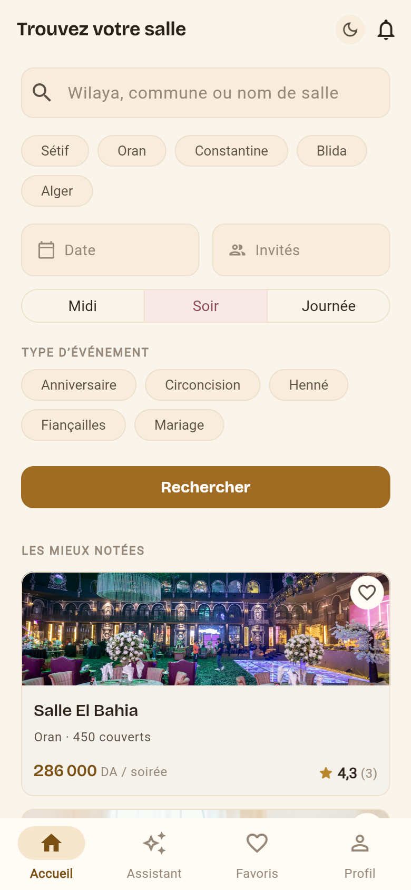
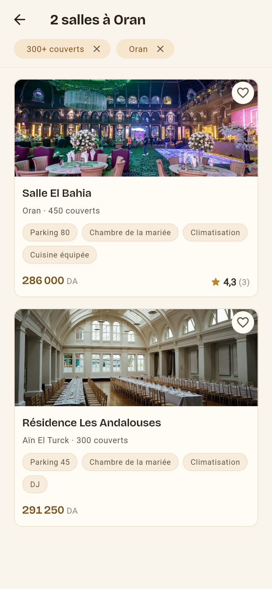
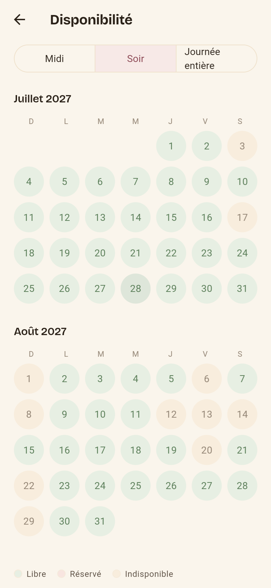
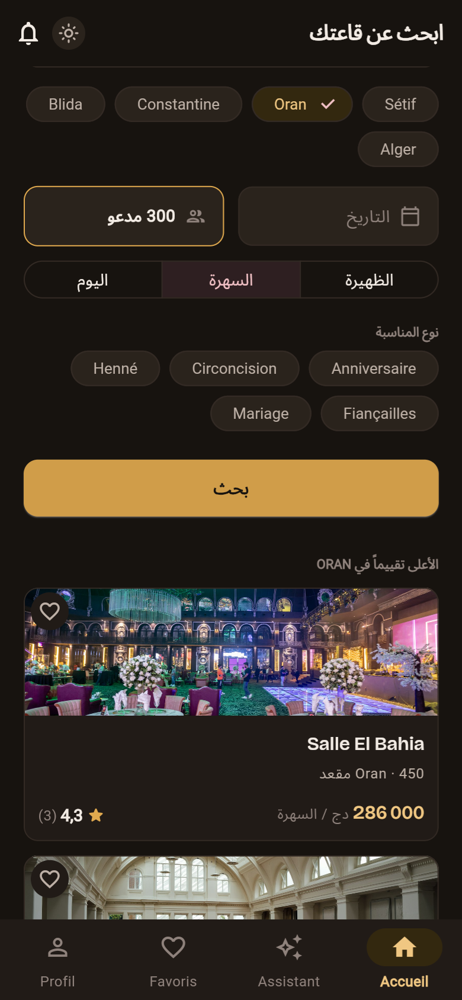
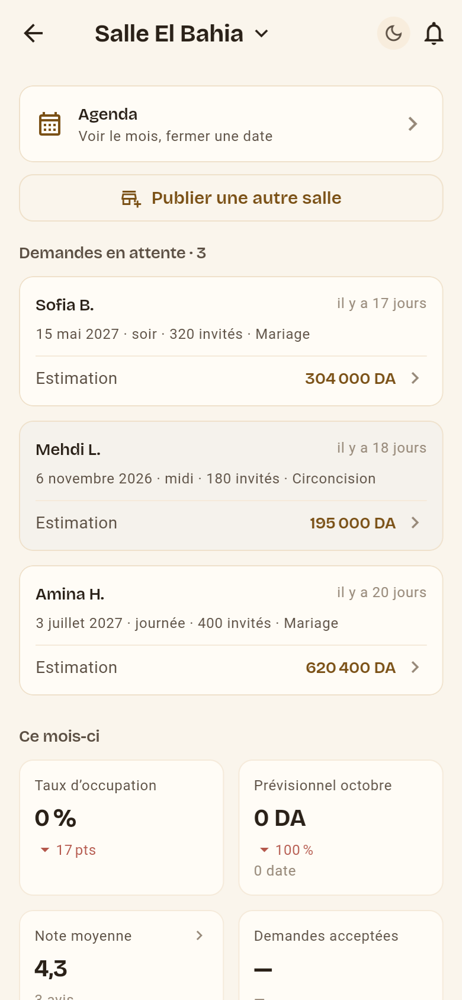
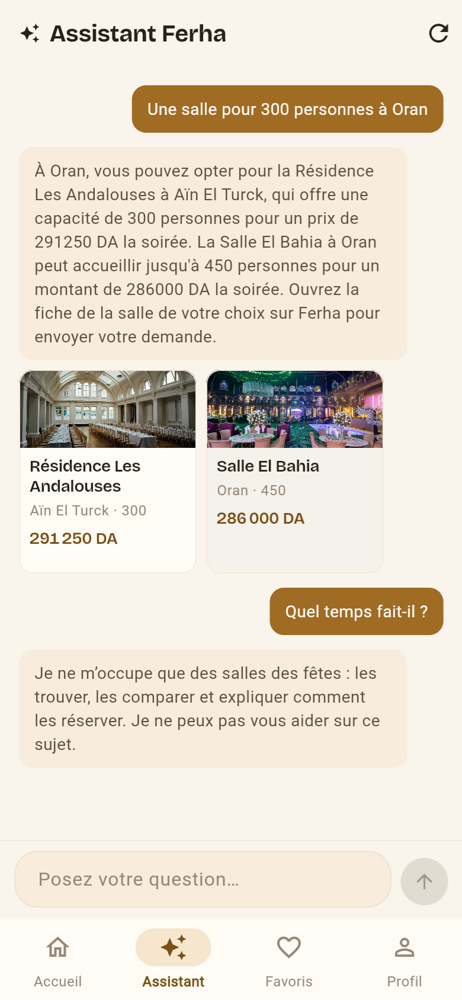

# Ferha

Application de réservation de salles des fêtes en Algérie, pour les familles qui
cherchent et les propriétaires qui louent. Flutter, français et arabe, sur une
base PostgreSQL.

**Voir l'application en ligne : <https://ferha.pages.dev>**

## Essayer en trois minutes

Deux boutons sur l'écran de connexion évitent toute inscription. Le parcours
ci-dessous fait le tour complet, des deux côtés.

1. Ouvrir <https://ferha.pages.dev> et toucher **« Entrer comme Amina
   (cliente) »**.
2. Sur l'accueil, chercher **Oran**, puis ouvrir **Salle El Bahia** — 450
   places, la salle la mieux garnie du catalogue.
3. Dans le calendrier, choisir le **samedi 18 septembre 2027**, créneau
   **soir**. La date est libre, et elle est en haute saison : le devis affiche
   la majoration.
4. Envoyer la demande. Elle part chez Karim, qui est le propriétaire de cette
   salle-là — c'est pour cela qu'on la choisit.
5. Se déconnecter, puis **« Entrer comme Karim (propriétaire) »**. La demande
   est en tête de sa file. L'ouvrir, **accepter**. Une option de 72 h se pose
   sur la date.
6. Revenir comme Amina. La réservation attend son acompte : choisir
   **l'acompte en espèces**, pas la carte.
7. Repasser chez Karim, ouvrir la demande, **confirmer l'encaissement**. La
   réservation passe en confirmée, des deux côtés.

**Prenez la carte seulement si vous voulez voir la page Chargily.** Le paiement
est en mode test et aucune somme n'est débitée — l'écran le dit —, mais la page
de Chargily n'est pas joignable depuis toutes les connexions. Le parcours
espèces, lui, ne quitte jamais l'application et marche partout.

**L'astuce qui vaut le détour : ouvrez deux fenêtres côte à côte.** Amina dans
la fenêtre normale, Karim dans une fenêtre de navigation privée — les deux
sessions ne se marchent pas dessus. Envoyez la demande chez Amina sans quitter
la fenêtre de Karim des yeux : **sa cloche s'allume pendant que vous regardez**,
sans rechargement. C'est la meilleure démonstration du projet, et personne ne la
trouve seul.

**Vous ne pouvez rien casser.** Tout ce qu'un visiteur fait sur les salles de
démonstration s'efface tout seul au bout de deux heures, et le décor — les
demandes en attente, les avis, les dates bloquées, jusqu'au rôle et à la langue
des deux comptes — se remet en place à chaque heure. Essayez tout, y compris
refuser, annuler et bloquer des dates. Voir [Le décor de
démonstration](#le-décor-de-démonstration).

## Captures













## Ce que ce dépôt montre

| | |
|---|---|
| Flutter en web et sur téléphone, thème clair et sombre livrés ensemble | [Identité visuelle](#identité-visuelle) |
| PostgreSQL : RLS sur chaque table, prix calculés en base et jamais en Dart, transitions d'état par fonctions sécurisées | [supabase/README.md](supabase/README.md) |
| Deux langues et deux sens de lecture, 205 tests pour le tenir | [L'arabe et le sens de lecture](#larabe-et-le-sens-de-lecture) |
| Recherche sémantique par vecteurs, par-dessus les filtres SQL | [La recherche sémantique](#la-recherche-sémantique) |
| Un assistant qui s'appuie sur le catalogue et refuse ce qu'il ne sait pas | [L'assistant](#lassistant) |
| Paiement d'acompte par carte algérienne, et en espèces | [Le paiement de l'acompte](#le-paiement-de-lacompte) |
| Mise en ligne automatique à chaque poussée sur `master` | [La mise en ligne](#la-mise-en-ligne) |
| Trois gardiens, et deux requêtes qui prouvent qu'ils ont servi | [Les gardiens](#les-gardiens) |

## Ce que ça ne fait pas, et pourquoi

Un projet qui ne dit pas ses trous demande qu'on les cherche. Voici les miens.

**Les tests SQL ne tournent pas tout seuls, et c'est le plus gros trou de ce
dépôt.** Vingt fichiers dans `supabase/tests/` vérifient ce que le Dart ne peut
pas vérifier : le prix qui ne vient que d'`estimate_price()`, la RLS qui isole
deux clients, le double créneau que la base refuse. La CI GitHub lance
`flutter analyze` et les 683 tests Dart à chaque push — **elle ne lance aucun
des vingt**. Ils se collent à la main dans l'éditeur SQL de Supabase, ou
s'enchaînent par la boucle `psql` documentée dans
[`supabase/README.md`](supabase/README.md#les-lancer-tous-en-une-seule-commande).

**Ce que ça a déjà coûté, deux fois.** Trois de ces tests ont pourri dix jours
sans que personne le voie : ils étaient écrits, ils étaient justes, et ils ne
tournaient pas. Et le 19 septembre 2026, le décor de démonstration en ligne
portait deux favoris au lieu de trois et un profil détourné — `etat_du_decor` le
disait depuis des heures, le test 17 de `tests/018` l'aurait crié, et personne
n'avait rien lancé. Un test qu'on n'exécute pas n'est pas un test : c'est une
intention, et elle passe au vert toute seule.

**Le chemin pour le combler, nommé.** Un Supabase LOCAL dans le robot GitHub —
`supabase start` pose Postgres dans un conteneur, `supabase db reset` y applique
les 39 migrations et les seeds, puis la même boucle `psql` enchaîne les
dix-neuf fichiers autonomes contre `localhost`. Aucun secret n'est nécessaire :
la base est jetable et naît vide à chaque exécution. Ce qui coûte, c'est de
faire tenir la pile Supabase dans le robot — l'image met des minutes à démarrer,
les seeds supposent des comptes GoTrue que `db reset` ne crée pas seul, et
`013` restera dehors de toute façon. C'est une journée, pas une ligne, et c'est
pour cela qu'elle n'est pas faite : elle est notée pour le J28, pas oubliée.

**Le paiement est en mode test.** Chargily tourne avec ses clés de bac à sable :
aucune somme n'est débitée, et l'écran de l'acompte le dit au client au lieu de
le laisser croire qu'il paie. Passer en production demande un compte marchand
vérifié, pas une ligne de code.

**La validation d'une salle n'existe pas encore, et c'est plus sévère que ça en
a l'air.** Le cahier des charges (ADM-01) veut qu'aucune salle ne soit visible
avant contrôle humain. La moitié protectrice est en place : une salle inscrite
depuis l'application naît en `draft`, passe en `pending` quand son propriétaire
l'envoie, et **rien ne la passe jamais en `published`** — ni fonction, ni écran,
ni déclencheur. Toutes les recherches filtrent sur `published`. Une salle
inscrite dans la démonstration n'apparaît donc nulle part, jamais. Le filet
existe ; c'est la console qui manque. En attendant, une surveillance horaire
compte ces salles — `salles_publiees_par_un_visiteur` dans la vue
`etat_du_decor` — et je les retire à la main.

**Le propriétaire ne peut pas saisir sa grille tarifaire** (OWN-03). Les quatre
éléments demandés existent en base et servent au calcul : prix de base par
créneau, majoration week-end, majoration de haute saison — juin à septembre — et
prix par couvert au-delà d'un seuil. Mais l'écran qui les saisit n'est pas
écrit. Or `search_venues()` joint `venue_pricing` par une jointure interne : une
salle sans tarif ne sort d'aucune recherche. L'application le dit en toutes
lettres à la fin du parcours d'inscription, plutôt que de laisser un
propriétaire attendre des demandes qui ne viendraient jamais.

**Les libellés venus de la base restent en français dans une page arabe.** La
nuance est ailleurs que là où on l'attend : les référentiels **sont** bilingues.
`wilayas` porte `name_fr` et `name_ar`, `event_types`, `amenities` et
`venue_options` portent `label_fr` et `label_ar` — toutes ces colonnes sont
`not null` et renseignées pour les 58 wilayas et tous les codes. C'est le client
Flutter qui ne les demande jamais : `search_providers.dart` écrit `name_fr` et
`label_fr` en dur, quelle que soit la langue active. Le réparer, c'est choisir
la colonne selon la langue — un après-midi. La barre d'onglets du bas — Accueil,
Assistant, Favoris, Profil — reste elle aussi en français dans la page arabe,
pour une raison plus simple encore : `lib/core/router/home_shell.dart` écrit ses
quatre libellés en dur au lieu de les lire dans l'ARB. Ce qui n'a, lui, aucune
traduction, c'est le contenu saisi par les propriétaires : `venues.name`,
`venues.commune`, `venues.description`, les motifs de dates bloquées et le texte
des avis. Celui-là demanderait un vrai circuit de traduction, pas une colonne.

**Les comptes de démonstration ne PEUVENT PAS porter de numéro de téléphone :
la base le refuse.** Un numéro algérien bien formé appartient à quelqu'un, et le
site est en ligne — c'est une décision, pas un état de fait. Un déclencheur
(`profiles_pas_de_telephone_en_demonstration`, migration 038) remet `phone` à
NULL sur tout compte `d0000000-…`, quelle que soit la porte empruntée : l'écran
de demande, la publication d'une salle, l'inscription, ou une écriture directe
par l'API. Il force au lieu de refuser, pour que le parcours ci-dessus aboutisse
normalement ; l'écran de demande le dit à qui tape un numéro.

Le mécanisme du §9 — le contact de l'autre partie révélé seulement après
acceptation, par `booking_contact()` — est bien là, et couvert par
`supabase/tests/007_adresse_et_telephone.sql` et
`supabase/tests/019_pas_de_telephone_en_demonstration.sql`. Il n'a simplement
rien à révéler sur un compte partagé : l'espace propriétaire affiche « ce client
n'a pas renseigné de numéro » au lieu d'un faux numéro. Chez un vrai client, le
numéro est conservé — c'est par lui que la salle rappelle.

**Cette règle-là a été écrite après coup, et c'est pour ça qu'elle est sûre.**
Le 17 septembre 2026, un visiteur connecté comme Amina a tapé son vrai numéro
sur l'écran de demande, et il s'est affiché en clair chez Karim : un compte
partagé plus un champ de coordonnées obligatoire, c'est le second qui remplit le
premier. Les seeds posaient bien `phone = null` et le §9 fonctionnait — rien
n'était cassé, et c'est justement pourquoi le correctif est descendu dans la
base plutôt que dans l'écran qui se trouvait être la porte du jour.

**`full_name` et `email` gardent, eux, la fenêtre que `phone` avait — décidé le
17 septembre 2026.** Ils ne sont pas empêchés, ils sont écrasés : le ménage du
décor les remet au bout de deux heures, donc jusqu'à trois heures peuvent passer
avant qu'un barbouillage ne disparaisse. Ce choix tient à trois choses — aucun
écran ne les écrit, il faut appeler l'API délibérément pour y toucher, et ce
qu'on y met est un dégât d'affichage, pas une coordonnée par laquelle on joint
quelqu'un. Ce n'est pas le même risque que le téléphone, et il ne justifiait pas
une seconde branche à tenir.

**La condition qui retourne cette décision est écrite d'avance** : le jour où
l'adresse du site est diffusée — un lien sur un CV, un article, un réseau — ces
deux champs méritent le même déclencheur que `phone`. Le calcul change avec le
nombre de gens qui passent, pas avec le code.

**Pas de SMS : la connexion se fait par adresse électronique et mot de passe.**
Et la messagerie intégrée de Supabase, en offre gratuite, n'envoie que quelques
messages par heure : une inscription normale peut donc ne jamais recevoir sa
confirmation. C'est la raison d'être des deux boutons de démonstration — ils ne
sont pas un raccourci de confort, ils sont le seul chemin fiable pour un
visiteur.

**Pas de notification sur téléphone** (FCM), et **pas de rappels J-7 ni J-1**.
Les deux types existent dans la contrainte de `notifications.type`, et rien ne
les écrit : la place est réservée, le déclencheur n'est pas posé. Les
notifications dans l'application, elles, fonctionnent et arrivent en temps réel.

**Le service d'empreintes dort.** Il tourne sur une offre gratuite qui endort
l'instance ; le premier appel après deux heures de silence coûtait 62 secondes.
Un gardien le réveille toutes les cinq minutes, et l'assistant abandonne le
service au bout de 2 secondes pour répondre sans vecteur plutôt que de faire
attendre. Voir [Les gardiens](#les-gardiens).

**Pas d'APK.** Sur un dépôt privé, un fichier attaché à une *Release* n'est pas
téléchargeable sans compte autorisé : le lien serait mort pour qui le reçoit.

## Configuration

Les identifiants Supabase ne sont pas dans le dépôt. Avant le premier
lancement :

```bash
cp env.example.json env.json
```

Puis remplissez les deux valeurs, prises dans votre tableau de bord Supabase,
**Project Settings › API** :

| Clé | Où la trouver |
|---|---|
| `SUPABASE_URL` | l'URL du projet, `https://xxxx.supabase.co` |
| `SUPABASE_ANON_KEY` | la clé publique — `anon`, aussi appelée *publishable* |

`env.json` est dans `.gitignore` : il ne partira jamais dans un commit.
`env.example.json`, lui, est versionné et ne contient que des valeurs vides.

La clé publique est publique au sens strict — elle part dans le bundle web et
n'importe qui peut la lire. **Ce n'est pas elle qui protège les données**, ce
sont les politiques RLS (§9). Elle reste hors du dépôt parce qu'elle désigne un
projet précis, et que changer de projet ne doit pas demander de changer le
code. La clé `service_role`, elle, ne doit apparaître **nulle part** dans cette
application.

Sans configuration, l'application ne démarre pas : elle affiche un écran qui
dit quelle clé manque et quoi faire.

## Lancer

```bash
flutter pub get
flutter run -d chrome --dart-define-from-file=env.json --print-dtd
```

`--dart-define-from-file` est obligatoire : les valeurs sont lues par
`String.fromEnvironment`, à la compilation. Un `flutter run` nu compile une
application sans identifiants, qui s'arrêtera sur l'écran de configuration.

## Vérifier

```bash
flutter analyze
flutter test
```

## Structure

```
lib/
  core/
    env/        clés lues à la compilation (--dart-define-from-file)
    l10n/       fichiers ARB (fr, ar) et langue active
    router/     go_router : 4 onglets, routes d'authentification, route cachée
    supabase/   le client Riverpod, et la session — qui est connecté
    theme/      palette « Ambre & ivoire », rayons, galerie de contrôle
  features/
    auth/          connexion, inscription, profil
    booking/       demande, devis, suivi des réservations
    favorites/     le cœur sur la carte, et l'onglet qui les rassemble
    notifications/ la cloche, l'écran, et le temps réel
    owner/         espace propriétaire : tableau de bord, agenda, publication
    search/        accueil (= recherche) et résultats
    venue/         fiche salle, galerie, calendrier
    reviews/       avis : dépôt, lecture, droit de réponse
    assistant/     l'assistant et son fil de conversation
  main.dart
supabase/
  functions/    cinq Edge Functions (Deno) : create-checkout, chargily-webhook,
                embed-venue, summarize-reviews, ai-chat
  migrations/   39 fichiers : schéma, RLS, prix, recherche, avis, agent, gardiens
  seed/         15 salles, 8 comptes, 24 réservations et 3 favoris de démonstration
  tests/        20 bancs d'essai SQL, de la double réservation aux favoris
  outils/       scripts de mise au point
services/
  embeddings/   le service Python qui transforme le texte en vecteurs (Render)
docs/
  captures/     les six images du README
```

**Le socle ne dépend d'aucune fonctionnalité, et la frontière passe par la
session.** `core/supabase/session_providers.dart` dit s'il y a QUELQU'UN —
le routeur s'en sert pour rediriger, la langue pour savoir s'il existe un
profil où écrire. Savoir QUI c'est est autre chose : `profilProvider` lit la
table `profiles`, avec ses colonnes et ses droits, et il vit dans
`features/auth/`. La seule exception est `core/router/`, qui importe tous les
écrans : nommer chaque destination est le travail d'un routeur, pas une
dépendance de travers.

**Dette notée, pas urgente (J28)** : une trentaine de symboles de `lib/` sont
publics alors qu'ils ne servent que dans leur propre fichier. Les passer en
privé est un vrai nettoyage — donc pas la veille d'une répétition générale.

La base de données a son propre document : [supabase/README.md](supabase/README.md).

## La recherche

L'accueil **est** la recherche (maquettes, écran 1) : où, quand, combien, et le
bouton part. Les résultats (écran 2) gardent les filtres actifs en tête, chacun
retirable d'un tap.

**Rien n'est filtré ni calculé en Dart.** Une seule fonction SQL,
`search_venues()`, prend les critères et renvoie des lignes déjà triées, déjà
tarifées. Le prix d'une carte est celui de la **date choisie**, majorations du
§5.2 comprises — pas un « à partir de », et pas un montant qui changerait entre
la liste et la fiche.

Le nombre d'invités sert deux fois : il écarte les salles trop petites, et il
entre dans le calcul du prix comme nombre de couverts. « 300 invités » affiche
donc le prix pour 300 couverts, supplément compris.

Les critères voyagent dans l'URL (`/resultats?wilaya=31&date=…`) et non dans
l'état : sur le web, une recherche se copie, se partage et survit à un
rechargement.

Le filtre **type d'événement** retire vraiment des salles : `venue_event_types`
dit ce que chaque salle accepte. Trois salles de démonstration refusent quelque
chose, pour que le filtre se voie à l'usage — le grand palais de Zéralda ne
fait que mariages et fiançailles, la petite salle d'Ouled Yaïch ne fait pas de
mariage. Une salle qui n'a **rien déclaré accepte tout** : le silence d'un
propriétaire ne vaut pas refus.

### Ce qui ne s'affiche pas

Une salle **sans avis n'a pas d'étoiles**. Pas « 0,0 (0) » : une salle neuve
n'est pas une salle mal notée. La base renvoie `NULL` plutôt que zéro, et
l'écran d'accueil intitule sa liste « Salles à découvrir » tant qu'aucune note
n'existe, « Les mieux notées » ensuite.

### Les trois états

| État | Ce qu'on voit |
|---|---|
| Chargement | des cartes squelettes, à la forme de ce qui arrive |
| Vide | ce qui bloque, **nommé**, et un bouton par critère à retirer |
| Erreur | le message traduit, un bouton Réessayer, et le détail technique repliable |

L'état vide ne dit jamais « aucun résultat » tout court : il nomme le critère le
plus probablement responsable — une date déjà prise, un budget sous le prix réel
d'un vendredi d'été — et chaque piste proposée est un bouton qui retire
vraiment ce critère.

### Sans compte

Chercher et consulter ne demandent **aucune connexion**. Voir la règle de
navigation plus bas.

## Comptes et connexion

Trois écrans : connexion, création de compte, profil. L'écran de connexion
porte les deux comptes de démonstration du cahier des charges (§4.1, CORE-01),
accessibles **en un tap** :

| Bouton | Compte | Ce qu'on voit |
|---|---|---|
| Entrer comme Amina | cliente | le point de vue par défaut, aucune salle |
| Entrer comme Karim | propriétaire | ses **4 salles** du catalogue de démonstration |

Ils supposent que `supabase/seed/003_demo_accounts.sql` a été lancé. Les
identifiants vivent dans `lib/features/auth/demo_accounts.dart`, et nulle part
ailleurs.

Le seed remplit `email_confirmed_at` sur ces comptes : ils fonctionnent donc
**même si « Confirm email » est actif** sur le projet Supabase. C'est
indispensable — personne ne recevra jamais de message à une adresse
`@demo.ferha.dz`.

En revanche, quand ce réglage est actif, une **inscription normale** depuis
l'application n'ouvre pas de session : l'écran affiche « Vérifiez votre boîte
mail », parce que c'est ce que le serveur a répondu. L'application ne fait rien
de plus — le parcours de confirmation n'est pas traité.

**La session survit à la fermeture de l'application** : le jeton est rangé dans
`localStorage` sur le web, dans `SharedPreferences` sur mobile, et restauré par
`Supabase.initialize()` avant la première image.

### La règle de navigation

> Un visiteur non connecté peut chercher une salle et consulter une fiche.
> La connexion n'est demandée qu'**au moment d'agir**.

C'est le parcours du §3, dont les deux premières étapes se font sans compte.
Le routeur n'a donc **aucune redirection globale** vers la connexion : une
redirection posée sur des routes de consultation transformerait l'application
en annuaire fermé.

Les écrans qui portent un geste — envoyer une demande, écrire à un
propriétaire, déposer un avis — appellent `exigerConnexion` :

```dart
if (!await exigerConnexion(context, ref)) return;
// ici, la session existe
```

Gratuit si la session existe déjà. Sinon l'écran de connexion s'ouvre
par-dessus, et se referme sur le geste interrompu.

### Messages d'erreur

`lib/features/auth/auth_messages.dart` traduit les erreurs de GoTrue en
français, à partir du **code** d'erreur — stable et documenté — et non du texte
anglais du serveur, qui change de version en version. Un code inconnu n'est pas
masqué : il est nommé, avec le message d'origine. « Une erreur est survenue »
fait perdre le temps qu'il prétend faire gagner.

## Les délais et les alertes

### L'option de 72 h s'éteint toute seule

Une demande acceptée pose une option de 72 h (§5.1). Sans acompte à l'échéance,
elle expire et **rend la date** — sans que personne n'appuie sur rien. C'est
`pg_cron` qui porte ce « sans personne » : `expire_options()` passe **toutes les
quinze minutes**, et une seconde tâche purge chaque nuit l'historique
d'exécutions de plus de sept jours. Les deux sont posées par une migration, pas
à la main dans le tableau de bord Supabase : un projet recréé repartirait sans
elles, avec des options qui n'expirent plus et personne pour s'en apercevoir.

**Une journée entière expire d'un bloc.** Elle occupe deux lignes de `bookings`
et n'est qu'une seule réservation : le midi libéré et le soir tenu ferait une
date invendable. Les deux parties sont prévenues — c'est aussi la date du
propriétaire qui vient de repartir à la vente — et chacune **une seule fois**.

Le détail est dans [supabase/README.md](supabase/README.md).

### La cloche, et l'écran

Une cloche en haut de l'accueil (écran 1 des maquettes) et dans la barre du
tableau de bord propriétaire. **La même cloche**, et pas une par espace : Karim
reçoit ses demandes sur ses salles, mais il peut aussi avoir réservé ailleurs —
deux compteurs qui se partageraient les notifications donneraient deux nombres,
et aucun des deux ne serait le bon.

La pastille ne montre jamais « 0 » : elle apparaît à un, et dit « 99+ » au-delà.
Le nombre vient de la base et porte sur **toutes** les non lues, pas sur les
cinquante lignes affichées — sinon le badge rétrécirait à mesure qu'on remonte
dans l'historique.

L'écran charge la liste à l'ouverture **et** écoute le temps réel. Les deux, pas
l'un ou l'autre : le service Realtime de Supabase démarre à froid quand le
projet a dormi, et une notification déposée pendant ces deux secondes-là ne
serait annoncée à personne.

Toucher une notification fait deux choses, dans cet ordre : elle s'éteint, puis
l'écran s'ouvre — le suivi des réservations pour la famille, le détail de la
demande pour le propriétaire. L'inverse laisserait la pastille allumée le temps
de la transition, et on croirait avoir mal appuyé.

**Aucun texte de notification n'est écrit en dur.** Le titre vient du type, la
ligne de détail du payload — nom de la salle, date, créneau, invités —, et le
payload est rempli par la base au moment où la notification naît. Il est donc
aussi **figé** : une salle renommée demain ne réécrit pas l'annonce d'hier.

### Ce qui manque encore

Le push téléphone (FCM), les e-mails, les rappels J-7 et J-1, l'écran qui
recevra l'invitation à laisser un avis (J17) et le bouton WhatsApp ne sont pas
faits. Les deux types `reminder_j7` et `reminder_j1` existent en base et
personne ne les dépose encore ; `review_invitation`, elle, est déjà déposée par
`complete_booking()` et mène au suivi des réservations faute d'écran dédié.

## Le paiement de l'acompte

Une demande acceptée propose « Verser l'acompte » dans « Mes réservations ». On
arrive sur l'écran 6 des maquettes : le compte à rebours des 72 h, le
récapitulatif, le montant, CIB ou Edahabia, et un bouton qui ouvre la vraie page
de paiement Chargily.

**En mode test, et seulement en mode test.** L'URL est celle du mode test de
Chargily Pay v2, `payments.is_test` vaut `true` sur chaque ligne écrite, et
l'écran le dit au client plutôt que de le cacher : « aucune somme n'est
réellement débitée ». Mieux vaut qu'il l'apprenne là que devant son relevé.

### La clé secrète ne quitte jamais le serveur

Elle vit dans les secrets de la Edge Function `create-checkout`, sous le nom
**`CHARGILY_SECRET_KEY`**, et nulle part ailleurs — ni dans `env.json`, ni dans
le dépôt, ni dans l'application. Flutter appelle la fonction avec **le jeton de
l'utilisateur** et n'apprend jamais qu'une clé existe. Le §9.4 du cahier des
charges le demande en toutes lettres : « un APK se décompile en quelques
minutes ».

Sans ce secret, la fonction répond `FE058` et l'écran dit que le paiement en
ligne n'est pas encore ouvert — sans nommer aucune clé.

Une seconde variable, **`APP_ORIGIN`**, est facultative. Posée, elle restreint
les adresses de retour à celles de ce domaine (les origines locales restent
acceptées, pour le développement). Le jour où l'application aura un domaine,
elle se remplit sans qu'une ligne de code change.

### Le montant vient de la base, et d'un seul arrondi

Chargily encaisse des **dinars entiers** ; `bookings.deposit_amount` est un
`numeric(12,2)`, parce que 25 % d'un devis tombe rarement rond. Il faut donc
arrondir, et **une seule fois** : c'est `montant_acompte()` (migration 024), au
dinar **supérieur** — l'acompte est un minimum convenu, et le solde du jour J
absorbe la différence au centime.

Trois endroits annoncent ce montant, et les trois lisent cette même fonction :
le bouton de « Mes réservations », l'écran 6, et la ligne `payments`. Sans cela,
le bouton dirait « 51 333 DA » et la caisse en demanderait 51 334.

Flutter n'envoie **aucun montant** : la Edge Function le lit dans la base pour
créer le checkout, et la base le relit une seconde fois au moment d'écrire.

### Une seule page de paiement par réservation

Un second « Payer » — double tap, retour arrière, page rechargée — ne crée pas
un second checkout. La fonction retrouve celui qui est déjà ouvert chez
Chargily et rend **la même URL**, tant qu'il est encore en attente et toujours
du bon montant. Une page neuve éteint la précédente : jamais deux paiements
« en cours » sur la même date.

### Revenir de Chargily ne confirme rien

C'est le point le plus important de cette étape. `success_url` ramène sur « Mes
réservations » avec un bandeau **« Paiement en cours de vérification »**, et la
réservation reste **acceptée**. Seul le webhook signé — le J16 — la fera passer
en « confirmée ». Le paramètre de retour s'appelle d'ailleurs `verification` et
non `succes` : le nom dit déjà qu'on ne sait pas encore.

### Ce qui confirme vraiment : le webhook

`chargily-webhook` est la seule chose qui fasse passer une réservation en
**confirmée**. Il tourne sans jeton Supabase — Chargily n'en a pas — et ce qui
le protège est **la signature**, vérifiée sur le corps brut avant tout décodage,
en HMAC-SHA256 avec la clé secrète. Signature fausse ou absente : 401, et rien
n'est écrit.

Il ne décide de rien d'autre. Le montant, l'option, le créneau, l'idempotence :
tout se joue en SQL, en une transaction, sur une ligne verrouillée. Recevoir
deux fois le même événement ne confirme pas deux fois.

**Un paiement encaissé ne confirme pas toujours.** Quand l'option a expiré
pendant le trajet, quand un autre a pris le créneau, ou quand la réservation
était déjà réglée, l'argent est arrivé et la date n'est pas prise. La base
marque la ligne « à rembourser », prévient les deux parties et
l'administration — et **ne rembourse rien toute seule**. Le détail est dans
[supabase/README.md](supabase/README.md).

### L'acompte en espèces

Le troisième choix de l'écran 6, et il marche maintenant. La légende de la
maquette dit pourquoi il compte : « elle sauve les utilisateurs réticents au
paiement en ligne ».

**Annoncer n'est pas payer.** Le client dit qu'il apportera les billets ; la
réservation reste acceptée, l'option de 72 h continue de courir, et le
propriétaire est prévenu. C'est lui qui confirme, depuis le détail de la
demande, une fois l'argent compté — et ce bouton demande confirmation, parce
qu'il prend la date pour de bon.

Le propriétaire lit le **même montant** que sa cliente : l'entier de
`montant_acompte()`, et non les centimes du montant convenu.

### Tester le paiement sans la page Chargily

La page de paiement n'est pas joignable depuis toutes les connexions
algériennes. Le webhook, lui, se teste entièrement sans elle :

```powershell
$env:CHARGILY_SECRET_KEY = 'test_sk_...'
.\supabase\tests\webhook_chargily.ps1 -Cas tout
```

Le script signe avec la vraie clé et vise la fonction déployée ; le décor se
pose et s'efface par `supabase/tests/013_webhook_bac_a_sable.sql`. La clé est
lue dans une variable d'environnement et n'entre dans aucun fichier.

### Ce qui manque encore

Sur téléphone, le paiement par carte renvoie à un navigateur — le lien
d'application Android n'est pas déclaré, et une page de paiement dont on ne
revient pas vaut moins qu'un refus qui le dit. Le parcours espèces, lui, marche
partout : il ne quitte jamais l'application.

Il n'y a pas encore d'écran d'administration pour les paiements à rembourser :
la vue `paiements_a_examiner` existe, et se lit pour l'instant dans l'éditeur
SQL.

## Les avis

Un avis exige une réservation **honorée**, et la règle est portée par le schéma
plutôt que par un écran : `reviews.booking_id` est `unique not null` vers
`bookings`. Pas de réservation, pas d'avis ; et jamais deux avis sur la même.

La fenêtre est étroite et elle n'est écrite qu'une fois, dans `fenetre_avis()` :
**J+1 à J+30** après l'événement. Avant, la soirée n'a pas eu lieu. Après, on ne
se souvient plus de la salle, on se souvient de son humeur. La politique RLS,
`client_bookings()`, `avis_a_deposer()` et `deposer_avis()` lisent toutes ces
deux bornes du même endroit.

Une journée entière occupe deux lignes de `bookings`, donc deux `booking_id`,
donc deux avis possibles si l'on s'arrêtait là. `reviews.booking_group_id`,
unique lui aussi, ferme la brèche : **un événement, un avis**. Il est renseigné
par un déclencheur, jamais par l'appelant.

Le propriétaire a un droit de réponse, une seule fois (OWN-06). Une fois qu'il a
répondu, l'avis est figé : laisser l'auteur réécrire sa note après coup rendrait
la réponse incompréhensible.

**Une salle sans avis n'a pas d'étoiles — et surtout pas zéro.** La note est
`null`, le champ `estNotee` est faux, et l'écran affiche un tiret. Zéro virgule
zéro serait un mensonge : ce n'est pas une mauvaise note, c'est une absence de
note. Quand il y a des avis, la note affichée est une **moyenne bayésienne**
(m = 5, C = 4,0) et non une moyenne simple : une salle avec un seul 5/5 ne doit
pas dépasser une salle qui tient 4,6 sur quarante avis.

## Les favoris

Un cœur sur la carte d'une salle, et cette salle se retrouve dans l'onglet
Favoris. C'est tout, et c'est voulu : **pas de dossiers, pas de notes, pas de
partage, pas de tableau de comparaison.**

**Le cœur vit sur la carte, pas sur les écrans qui l'utilisent.** La même
`VenueCard` dessine une salle sur l'accueil et dans les résultats : poser le
cœur dessus le fait apparaître aux deux endroits sans dupliquer une ligne. La
fiche salle porte le même widget et le même fournisseur derrière — retirer un
favori depuis la fiche l'éteint aussi dans les résultats, sans que l'un ait à
prévenir l'autre.

**Il s'allume au doigt, et il se rééteint si la base refuse.** L'état passe à
l'écran d'abord, part vers la base ensuite, et **revient en arrière** si elle dit
non — avec un message qui explique pourquoi. Un cœur resté allumé sur un favori
qui n'existe pas serait le même mensonge qu'un prix qui changerait entre la liste
et la fiche.

**Le geste interrompu se termine.** Un visiteur sans compte qui touche le cœur ne
perd pas son geste : l'écran de connexion s'ouvre par-dessus, et quand il se
referme sur une session valide, **le cœur s'allume tout seul**. La personne n'a
pas à retrouver la salle et à retoucher le cœur — elle a déjà dit ce qu'elle
voulait. C'est la règle de navigation habituelle (voir plus haut) : on demande la
connexion au moment d'agir, jamais à l'entrée.

**L'onglet n'éjecte personne.** Sans compte, il explique pourquoi un favori se
range sur un compte plutôt que sur l'appareil, et propose de se connecter. Il ne
redirige pas : le routeur n'a aucune redirection globale, et cet onglet n'en
gagne pas une. Vide, il ne dit pas « aucun favori » — il nomme le geste qui
manque, « touchez le cœur sur une salle pour la retrouver ici », et donne un
bouton qui ramène à la recherche.

**Aucun compteur « 12 personnes aiment cette salle ».** La RLS ne rend que mes
lignes, donc ce chiffre n'existe pas — et sur un catalogue de démonstration il
serait une preuve sociale fabriquée. C'est le même refus que pour les numéros de
téléphone des comptes partagés.

Enfin, **les favoris d'Amina font partie du décor** : trois salles, remises en
place à chaque heure ronde comme les réservations et les dates bloquées. Un
visiteur qui pose cinq cœurs en voit cinq pendant sa visite ; à l'heure suivante
il n'en reste que les trois du décor. Sans cela, « Entrer comme Amina » ouvrirait
dans une semaine les favoris de trente inconnus.

### Ce qui manque encore

- **LE PRIX ET LA DISPONIBILITÉ POUR UNE DATE, À CÔTÉ DE CHAQUE FAVORI.** C'est
  la suite logique, et c'est le vrai besoin : une famille visite six salles et
  veut savoir laquelle a encore le samedi. Ce n'est pas construit, et la raison
  est que **l'onglet Favoris ne porte aucune date**. Le prix affiché sur une
  carte vient d'`estimate_price()` pour aujourd'hui, le soir, une personne —
  les valeurs d'attente de l'accueil, là où aucune date n'est encore choisie.
  Afficher « libre le 14 juin, 210 000 DA » demanderait de porter une date dans
  l'onglet, de la faire choisir, de la retenir, puis d'interroger
  `tient_la_date()` **et** `estimate_price()` pour chaque salle de la liste :
  le coût de la page double, et l'écran cesse d'être une liste pour devenir une
  seconde recherche. Le jour où on le fera, ce sera avec une date unique posée
  en haut de l'onglet, pas une par carte.

## La recherche sémantique

Les filtres SQL répondent à « Oran, 300 personnes, avec parking ». Ils ne
répondent pas à « une salle lumineuse pas trop loin de la mer pour un mariage
d'été » : aucune colonne ne porte « lumineuse ». La recherche sémantique
travaille sur le sens plutôt que sur les colonnes, et vient **par-dessus** le
filtre — elle ne le remplace pas, elle reclasse ce qu'il a laissé passer.

Chaque salle est résumée en un document bilingue — nom, commune, wilaya en
français **et en arabe**, types d'événement, équipements — puis transformée en
vecteur. Le modèle est **`intfloat/multilingual-e5-small`**, en **384
dimensions**, servi par un petit service Python sur Render. Bilingue à dessein :
la moitié des questions arrivent en arabe, et il faut qu'elles tombent sur les
mêmes salles.

**Quand le service dort, la recherche continue sans lui.** L'instance gratuite
s'endort, et le premier appel coûtait 62 secondes. L'assistant abandonne
désormais au bout de 2 secondes et répond avec les filtres seuls : le classement
est moins fin, la réponse arrive. Abandonner ne coûte pas le réveil — Render
démarre l'instance dès que la requête atteint son routeur et poursuit même si le
client s'en va — donc le premier visiteur paie 2 secondes au lieu de 62, et le
suivant trouve un service chaud.

## L'assistant

Il répond sur le catalogue et sur le parcours de réservation. **Il refuse le
reste, et c'est le travail, pas une limite subie.** Entre une réponse inventée
et « je ne sais pas », le second garde la confiance ; le premier la perd une
fois pour toutes. « Quel temps fait-il ? » n'obtient pas de réponse. « Comment
réserver ? » en obtient une.

Les procédures qu'il récite — le parcours en six étapes, l'acompte de 25 %,
l'option de 72 h — sont des **textes écrits à la main**, en français et en
arabe, constants dans `supabase/functions/ai-chat/index.ts`. Le modèle ne les
compose pas : il les rend. C'est moins souple qu'une base de connaissances, et
cela a un avantage qu'aucune base de connaissances n'a — ces textes ne peuvent
pas se tromper. La version arabe existe séparément non pour traduire, mais pour
garantir : quelqu'un qui écrit en arabe mérite le repli dans sa langue.

Ce qu'il sait faire, ce qui l'a fait échouer pendant la mise au point, et le
banc des trente questions qui le tient sont écrits dans
[`supabase/functions/ai-chat/README.md`](supabase/functions/ai-chat/README.md).

## L'arabe et le sens de lecture

L'arabe n'est pas une traduction posée sur une interface française : c'est un
second sens de lecture, et il retourne la mise en page entière. Le projet s'y
tient par **217 tests** — 152 dans les quatre fichiers nommés pour l'arabe, 46
qui interdisent qu'un texte français soit écrit en dur hors des fichiers ARB,
13 sur les formats, et 6 qui balayent les deux ARB caractère par caractère.

Quatre décisions ne se devinent pas, et ce sont elles que les tests protègent :

- **les chiffres restent latins.** Prix, capacités, dates : les chiffres
  indo-arabes orientaux ne sont pas ceux qu'on lit en Algérie ;
- **les icônes directionnelles se retournent, les autres non.** La flèche de
  retour change de côté, la loupe reste une loupe ;
- **le calendrier commence toujours par dimanche**, dans les deux langues ;
- **les mois portent leurs noms algériens** et non les noms du Machrek.

Le détail — quelle clé pour quel écran, ce qui se traduit et ce qui ne se
traduit pas, comment ajouter une chaîne — vit dans
[`lib/core/l10n/README.md`](lib/core/l10n/README.md).

### Ce qui manque encore

- **LA RELECTURE ARABE SUIT UNE LISTE D'ÉCRANS ÉCRITE À LA MAIN, ET UNE LISTE
  ÉCRITE À LA MAIN ARRIVE TOUJOURS UN CRAN DERRIÈRE LE DERNIER ÉCRAN.**
  `relecture_arabe_test.dart` monte onze écrans qu'il nomme un par un. Les
  quatre contrôles sont bons — débordement, français resté à l'écran, chiffres
  arabes-indiens, icônes retournées — mais ils ne regardent que ce qu'on a
  pensé à leur donner. Or c'est sur le dernier écran écrit que les défauts se
  trouvent, et le dernier écran écrit est justement celui qui n'est pas encore
  dans la liste. L'onglet Favoris l'a montré : ses dix chaînes arabes sont
  restées illisibles cinquante heures dans l'arbre de travail alors que le
  contrôle qui les aurait attrapées existait déjà et tournait soixante fois.

  La sortie n'est pas d'ajouter chaque écran à la main en se promettant de ne
  pas oublier — c'est ce qu'on fait aujourd'hui, et c'est ce qui échoue. Il
  faudrait que le banc TROUVE les écrans au lieu de les recevoir : parcourir
  `lib/features/**/**_screen.dart`, et faire échouer le test sur tout écran qui
  n'est ni monté ni explicitement écarté avec sa raison. Le coût réel n'est pas
  le parcours, c'est que chaque écran demande ses propres fournisseurs — l'état
  vide, l'état d'erreur — et qu'aucun ne se monte tout seul. C'est un travail
  de J27, pas une ligne.

  En attendant, `test/encodage_des_arb_test.dart` montre la forme que doit
  prendre un gardien : **il ne suit aucune liste**. Il lit les deux ARB en
  entier et n'a rien à apprendre quand un écran s'ajoute. Il n'attrape qu'une
  famille de défauts sur quatre, mais celle-là, il l'attrapera toujours.

## La mise en ligne

Le site part sur **Cloudflare Pages**, en mode *Direct Upload* : GitHub Actions
compile `flutter build web` puis **envoie** le résultat. Cloudflare ne lit pas
le dépôt.

**Pourquoi pas GitHub Pages :** il exige un dépôt public, et le code reste
fermé. Cette seule ligne écarte l'hébergeur le plus évident. Cloudflare Pages
lit les dépôts privés, ne demande pas de carte bancaire, et n'endort pas le site
— contrairement à Render, qui héberge le service des empreintes.

**Le piège, et il est silencieux :** `wrangler pages deploy --branch=…` publie en
PRODUCTION si la branche correspond à la branche de production déclarée dans le
projet, et en APERÇU sinon. Un aperçu s'ouvre à une adresse qui change à chaque
envoi, pendant que l'adresse publique reste figée sur le premier envoi manuel —
**sans qu'aucune erreur ne soit levée**. Symptôme : le site ne bouge plus alors
que le workflow est vert. Ce dépôt est sur `master`, pas sur `main` : c'est
`master` qui doit être déclarée branche de production.

Le reste — les cinq secrets, les adresses de retour de l'authentification,
`APP_ORIGIN` pour le paiement, la vérification que le site est vivant — est dans
[`docs/deploiement.md`](docs/deploiement.md), écran par écran.

## Les gardiens

Trois choses s'éteignent toutes seules dans ce projet, chacune pour une raison
différente. Trois gardiens les tiennent éveillées.

| Gardien | Rythme | Ce qu'il garde |
|---|---|---|
| `maintien-supabase.yml` (GitHub Actions) | toutes les 48 h | le projet Supabase, qu'une semaine sans activité met en pause |
| `ferha-reveil-empreintes` (pg_cron) | toutes les 5 min | le service d'empreintes sur Render, qui s'endort |
| `ferha-menage-du-decor` (pg_cron) | toutes les heures | le décor de démonstration, qu'un visiteur défait |

Le premier ne peut pas être un `pg_cron` : **un `pg_cron` ne tourne pas dans un
projet en pause**, il ne peut donc pas l'en sortir. Le réveil doit venir de
dehors. À l'inverse, les 5 minutes du second coûteraient plus de 8 000 minutes
d'Actions par mois — largement au-dessus des 2 000 d'un dépôt privé — alors
qu'un `pg_cron` ne se paie nulle part.

**Un voyant vert au-dessus d'un service mort est le défaut qu'on a rencontré
deux fois ici.** Une tâche qui dépose une requête vers une adresse morte est
enregistrée « succeeded ». Un ping HTTP réussit contre une page de maintenance.
Les deux requêtes ci-dessous ne disent pas que les gardiens se sont *exécutés* :
elles disent ce que les services ont *répondu*.

```sql
select * from public.etat_du_gardien;   -- le code HTTP et le corps rendus par le service
select * from public.etat_du_decor;     -- ce qui est sale dans la démonstration, maintenant
```

`etat_du_gardien` garde la vraie réponse — code et corps — parce que
`cron.job_run_details` ne dit que si la tâche a tourné. Le corps rendu contient
le nom du modèle et sa dimension : c'est la preuve que le service qui a répondu
est bien celui qu'on croit.

Le chiffre qui résume le travail : **le pire cas d'attente est passé de 62
secondes à 2 secondes**. 62 s, c'était le premier appel après deux heures de
silence, mesuré. 2 s, c'est la borne au-delà de laquelle l'assistant cesse
d'attendre et répond sans vecteur — et comme le gardien frappe toutes les 5
minutes, le service est chaud et répond en 85 à 573 ms.

## Le décor de démonstration

Les visiteurs entrent en un tap, comme Amina ou comme Karim. Tout ce qu'ils font
est donc fait **au nom des comptes de démonstration**, et reste après eux — y
compris ce qu'ils *défont*. Un visiteur entré comme Karim qui refuse une demande
ne crée rien : il vide la file de l'écran 9. Au bout de cinq visiteurs, la
meilleure page du projet ne montre plus rien.

Le ménage distingue donc **le décor** de ce qui est arrivé après, par les
préfixes d'identifiant que les seeds posent exprès : `b0000000-` pour une
réservation du décor, `5a11e000-` pour une salle, `d0000000-` pour une personne.
Une réservation créée depuis l'application passe par `request_booking()`, donc
par un identifiant tiré au sort : elle ne peut pas porter le préfixe. Le critère
ne regarde jamais *qui* a réservé — un visiteur **est** Amina.

**Ce qui se remet en place tout seul :** les réservations du décor et leur état,
les avis, les dates bloquées, les notifications, et les personnes — nom, adresse,
langue, et le rôle de propriétaire. Une empreinte, prise au sortir du seed,
décrit l'état juste ; le ménage y ramène la base.

**Ce qui ne se remet pas :** une salle inscrite par un visiteur. Elle porte un
identifiant aléatoire et reste en `pending`, invisible. La vue `etat_du_decor`
la compte, et `seed/002_reset_demo.sql` l'efface en la nommant — mais rien ne le
fait à l'heure.

**L'ordre de restauration est un garde-fou, pas une préférence.** Les
réservations de visiteurs partent d'abord, sinon l'une d'elles, confirmée sur un
créneau du décor, ferait échouer la réinsertion sur l'index d'unicité. Et les
saisies d'un profil se remettent avant son rôle, parce que le déclencheur
`updated_at` rajeunit la ligne à chaque écriture : dans l'autre sens, la
condition de délai ne serait plus jamais vraie et le nom ne reviendrait jamais.

Deux horloges, enfin. Rien n'est touché avant **deux heures** — un visiteur qui
teste dix minutes garde ce qu'il vient de faire sous les yeux. Sauf le rôle de
propriétaire, qui se remet **sans délai** : l'application n'écrit jamais ce
champ, il n'y a donc aucune saisie en cours à protéger, et tant qu'il est faux
« Entrer comme Amina (cliente) » ouvre l'espace propriétaire à tout le monde.

Le détail est dans [`supabase/README.md`](supabase/README.md), et le banc
d'essai dans `supabase/tests/018_le_decor_se_remet_en_place.sql`.

## Identité visuelle

La palette « Ambre & ivoire » du cahier des charges (§10.1) vit dans une seule
`ThemeExtension`, `FerhaColors` : c'est le seul fichier du projet où une valeur
hexadécimale est écrite. Un écran lit ses couleurs par `context.ferhaColors`.

Les deux thèmes, clair et sombre, sont livrés ensemble, et un petit bouton rond
— soleil ou lune — les échange depuis la barre du haut, à côté de la cloche et
là où vit déjà la bascule de langue. Le choix est retenu par l'appareil et
survit au rechargement de la page.

Tant que personne n'y a touché, l'application suit le **réglage du système**, et
c'est délibéré : un téléphone en sombre doit ouvrir Ferha en sombre sans qu'on
ait rien à demander. Le modèle porte donc trois états — « système », « clair »,
« sombre » — là où le bouton n'en montre que deux : il annonce ce vers quoi il
mène, jamais l'état courant.

La police d'affichage, Bricolage Grotesque, est embarquée en un seul fichier
variable : `assets/fonts/BricolageGrotesque-Variable.ttf`. Les styles pilotent
ses axes `wght` et `opsz` — l'application n'a donc besoin d'aucun réseau pour
s'afficher correctement, dès le premier lancement.

## Galerie de contrôle

La route `/_design` affiche chaque couleur avec son code, l'échelle
typographique, les boutons, les puces, la carte de salle, les trois états du
calendrier, et les deux bascules d'affichage — fr / ar, clair / sombre. Elle n'apparaît dans aucune barre d'onglets.

```bash
flutter run -d chrome --dart-define-from-file=env.json --print-dtd
# puis /_design dans la barre d'adresse
```

Depuis le code : `context.go(FerhaRoutes.design)`.

Elle a porté un temps un encart « État de la connexion », le temps de brancher
l'application sur la base. Il a été retiré : l'écran de recherche lit désormais
les mêmes données pour de bon, et une panne s'y verra sans instrument dédié.

## Documents

- `docs/cahier-des-charges_1.html` — cahier des charges v2.0
- `docs/maquettes.html` — maquettes des écrans
- [`docs/deploiement.md`](docs/deploiement.md) — la mise en ligne du web sur
  Cloudflare Pages, écran par écran, dépôt privé compris
- [`supabase/README.md`](supabase/README.md) — la base : migrations, RLS, prix,
  tâches planifiées
- [`lib/core/l10n/README.md`](lib/core/l10n/README.md) — les deux langues et le
  sens de lecture
- [`supabase/functions/ai-chat/README.md`](supabase/functions/ai-chat/README.md)
  — l'assistant et son banc d'essai
- [`docs/captures/A-PRENDRE.md`](docs/captures/A-PRENDRE.md) — ce que chacune des
  six captures doit montrer

## Licence

Le code est sous licence MIT — voir [LICENSE](LICENSE).

Bricolage Grotesque est sous SIL Open Font License 1.1 — voir
[assets/fonts/OFL.txt](assets/fonts/OFL.txt).
